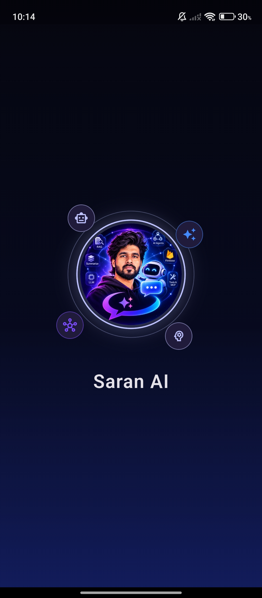
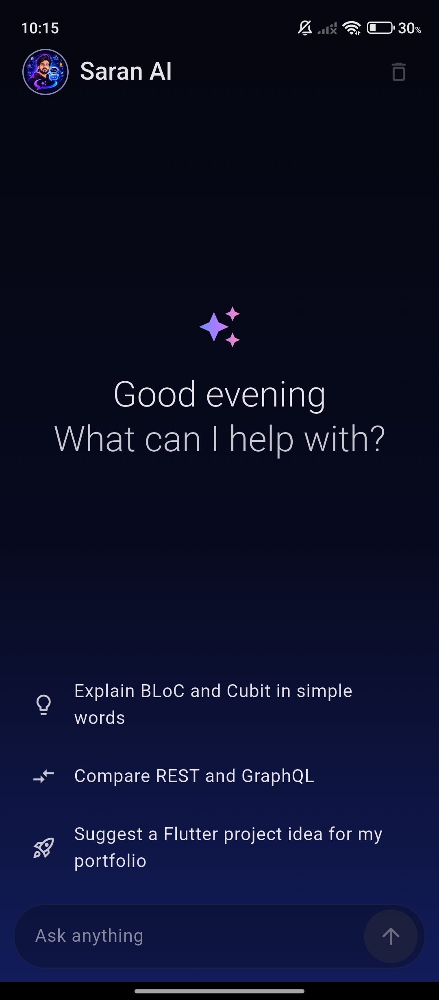
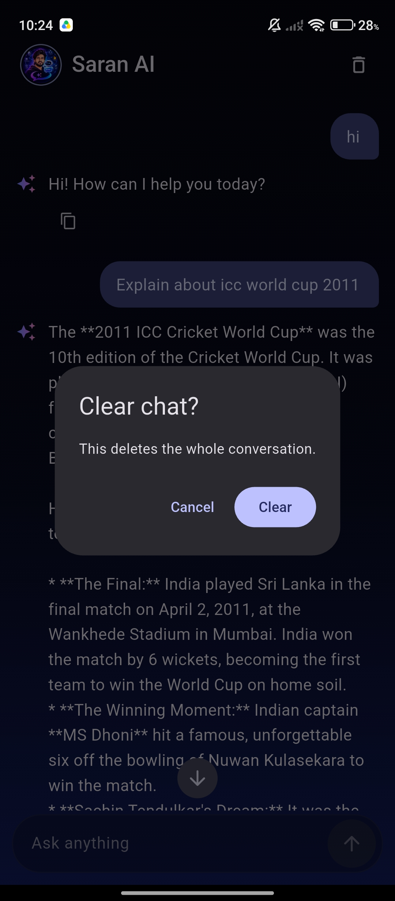
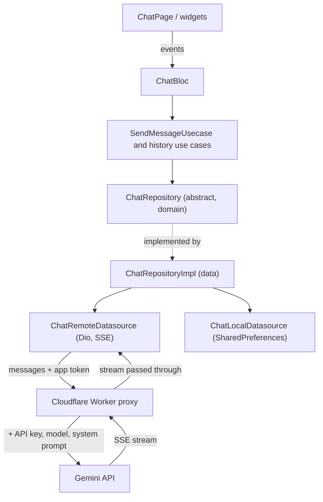

# Saran AI - Chat Assistant

A Flutter chat app powered by the Google Gemini API, routed through a small serverless proxy on Cloudflare Workers so the Gemini API key never ships inside the app. Answers stream in live, errors are handled with specific messages, and the conversation is saved on the device. Built with Clean Architecture and BLoC.

> Part of my Flutter + AI portfolio. This repo grows milestone by milestone; see the [roadmap](#roadmap).

## Screenshots

### Splash



### Empty Chat



### Chat


### Clear Chat



## Features

- **Live streaming answers** using Server-Sent Events, with a typewriter effect so large chunks still read naturally
- **Conversation context**: the full history is sent with each request, because the API is stateless
- **Stop generation** while an answer is streaming, keeping the text received so far
- **Specific error messages** for no internet, timeouts, rate limit (429), service busy (503), rejected access and blocked content, with **Retry** only where retrying makes sense
- **Chat history saved locally** and restored on restart, with a clear-chat action
- **Serverless backend proxy** that keeps the Gemini key, model choice and system prompt on the server, and falls back to other models when one is busy, missing or rate limited
- **Polished UI**: dark gradient theme, suggestion starters, animated typing indicator, copy button, scroll-to-latest button
- **Unit-tested** use case and bloc logic using a fake repository (no network, no API key)

## Tech stack

| Area | Choice |
|---|---|
| App | Flutter and Dart |
| State management | `flutter_bloc` with `equatable` |
| Dependency injection | `get_it` |
| Networking | `dio` (streamed responses) |
| Local storage | `shared_preferences` |
| Backend | Cloudflare Workers (JavaScript), free plan |
| AI | Google Gemini API over REST, called only by the Worker |
| Tests | `flutter_test` with a hand-written fake repository |

## Architecture

The app follows Clean Architecture with a feature-based structure. The domain layer is plain Dart and knows nothing about Gemini, Dio or Flutter widgets. Gemini-specific details live in the Worker.



### Request flow

1. The user sends a message and the UI dispatches `SendMessageEvent`.
2. `ChatBloc` appends the user message and an empty assistant placeholder, then calls `SendMessageUsecase` with the history **without** the placeholder.
3. The repository converts entities to simple `{role, text}` models, and the remote datasource POSTs them to the Worker.
4. The Worker checks the app token, validates the payload (size and role limits), translates it to Gemini's format, and calls Gemini's streaming endpoint. If a model returns 503, 404 or 429, or does not start responding in time, it tries the next model in its list.
5. The Worker returns Gemini's event stream unchanged. The datasource decodes the bytes, splits lines, parses each `data:` event, and yields text fragments as a `Stream<String>`.
6. The bloc appends each fragment to the assistant message and emits a new state, so the UI updates live.
7. When the stream finishes, fails or is stopped, the history is saved locally.

### Folder structure

```
backend/
  src/index.js         Worker: auth, validation, model fallback, stream passthrough
  wrangler.jsonc       Worker settings
ai_chat_assistant/lib/
  core/
    config/            app configuration (proxy URL and app token)
    network/           Dio client for the proxy
    dependencies/      GetIt setup
    theme/             light and dark themes
    utils/             typewriter stream helper
    common_widget/     shared UI pieces
  feature/chat/
    data/
      model/           MessageModel (entity <-> proxy and storage JSON)
      datasource/      remote (Dio, SSE) and local (SharedPreferences)
      repository/      ChatRepositoryImpl
    domain/
      entity/          MessageEntity
      failure/         ChatException and error types
      repository/      ChatRepository (abstract)
      usecase/         send, get, save and clear history
    presentation/
      bloc/            ChatBloc, events, state
      pages/           ChatPage
      widgets/         message bubble, input bar, typing indicator, empty view
```

## Key design decisions

- **`Stream<String>` through every layer.** Streaming is modeled as a stream from datasource to bloc, so the UI never needs to know how the data arrives.
- **One state class with a status field**, not a separate class per state. The message list must survive an error, and `copyWith` plus `Equatable` keep updates cheap while the last message grows.
- **Typed `ChatException`** carries an error type and a `canRetry` flag, so the UI shows the right message and only offers Retry when it can help.
- **Placeholder never sent.** The empty assistant bubble exists only in UI state, because the API rejects empty messages.
- **Provider-neutral app, provider-specific server.** The app sends `{role, text}`. Gemini's request format, role names, model and system prompt live in the Worker, so changing the model or prompt needs a redeploy and not an app release.
- **Model fallback with a start timeout.** The Worker tries several models and gives each a limited time to start responding. It stops waiting only until the response begins, so long answers are never cut off.
- **Persistence behind the repository.** History is saved when a turn ends, not per streamed fragment. Swapping SharedPreferences for a database later changes one datasource.
- **Typewriter in the presentation flow, not the data layer.** The datasource returns exactly what the API sends, and pacing is a display concern.

## Getting started

Requirements: Flutter SDK, Node.js (LTS), a device or emulator, a free [Cloudflare](https://cloudflare.com) account, and a free API key from [Google AI Studio](https://aistudio.google.com). No credit card is needed for either free tier.

### 1. Deploy the proxy

```bash
cd backend

# Generate a random APP_TOKEN:
#   Windows (PowerShell): [guid]::NewGuid().ToString('N')
#   macOS / Linux:        openssl rand -hex 16

# Create local secrets (git-ignored) in backend/.dev.vars:
#   GEMINI_API_KEY=<your_key>
#   APP_TOKEN=<generated_token>

npx wrangler login
npx wrangler secret put GEMINI_API_KEY
npx wrangler secret put APP_TOKEN
npx wrangler deploy
```

`wrangler deploy` prints your Worker URL. For local testing without deploying, run `npx wrangler dev`.

### 2. Run the app

```bash
cd ai_chat_assistant
cp env.example.json env.json      # set PROXY_URL and the same APP_TOKEN
flutter pub get
flutter run --dart-define-from-file=env.json
```

`env.json` and `.dev.vars` are git-ignored. After changing `env.json`, stop and restart the app completely, because hot reload does not re-read build-time values. In VS Code, start the app from the Run and Debug panel with a launch configuration that passes `--dart-define-from-file`.

### Run the tests

```bash
cd ai_chat_assistant
flutter test
```

The tests use a fake repository, so they need no key, network or device.

## Known limitations

- **The app token is not strong protection.** It is compiled into the app and can be extracted from the APK. It only stops casual abuse of the public Worker URL. The Gemini key itself is not in the app. Real protection needs user authentication (see roadmap).
- Free-tier quotas on Gemini are limited, and a message that triggers fallbacks can use several requests.
- Gemini models can be slow or temporarily unavailable. The Worker's fallback and timeout reduce, but do not remove, long waits.
- Responses are plain text. Markdown is not rendered.
- The model has a knowledge cutoff and no web access, so it cannot answer questions about recent events.
- The HTTP request is not aborted on Stop; only the stream subscription is cancelled.

## Roadmap

- [x] Streaming chat, error handling, local history, tests
- [x] Serverless proxy so the API key never ships in the app
- [ ] Summarizer and content-generator modes with structured JSON output
- [ ] Document Q&A with RAG (chunking, embeddings, vector search)
- [ ] Personal assistant with memory and tools
- [ ] MCP server and vector database
- [ ] User authentication, monitoring and production hardening

---

Built by Saran M K.