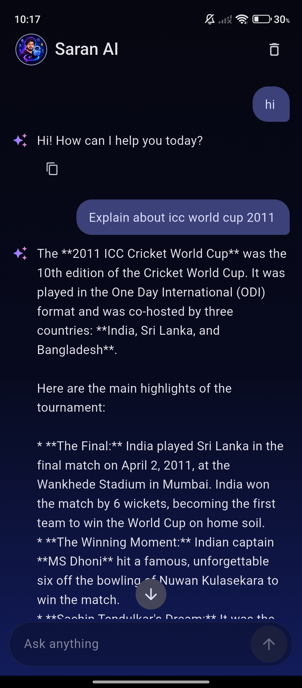
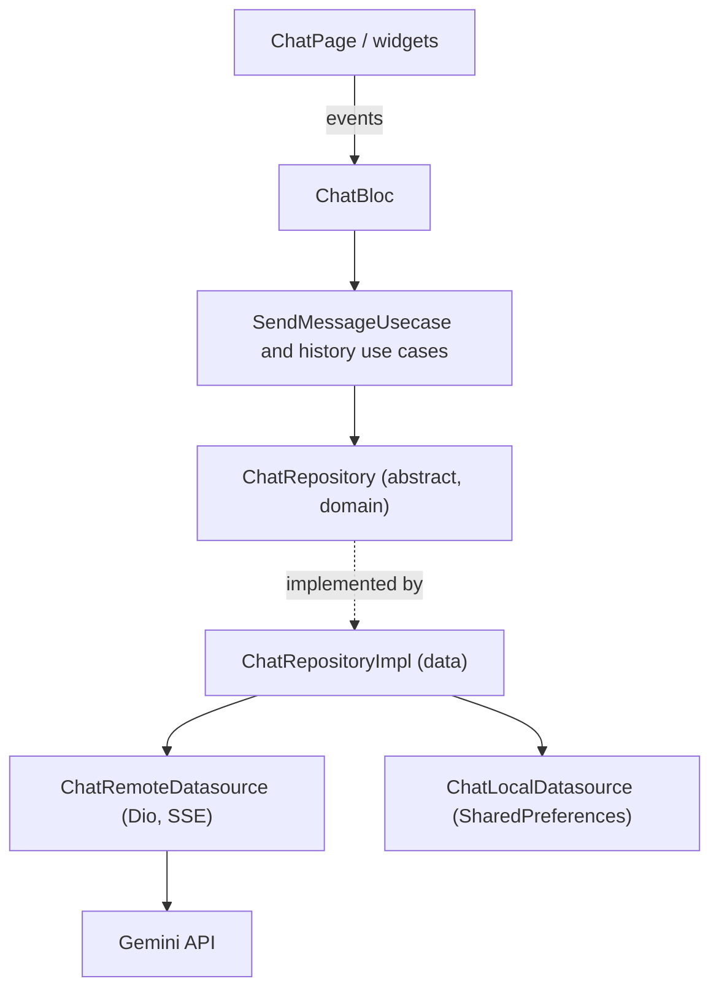

# Saran AI - AI Chat Assistant

A Flutter chat app powered by the Google Gemini API. Answers stream in live, errors are handled with specific messages, and the conversation is saved on the device. Built with Clean Architecture and BLoC.

> Part of my Flutter + AI portfolio. This repo grows milestone by milestone; see the [roadmap](#roadmap).

## Screenshots

### Splash


### Empty Chat


### Chat



### Clear Chat


## Features

- **Live streaming answers** using Server-Sent Events, with a typewriter effect so large chunks still read naturally
- **Conversation context**: the full history is sent with each request, because the API is stateless
- **Stop generation** while an answer is streaming, keeping the text received so far
- **Specific error messages** for no internet, timeouts, rate limit (429), service busy (503), rejected key, unavailable model and blocked content, with **Retry** only where retrying makes sense
- **Chat history saved locally** and restored on restart, with a clear-chat action
- **Polished UI**: dark gradient theme, suggestion starters, animated typing indicator, copy button, scroll-to-latest button
- **Unit-tested** use case and bloc logic using a fake repository (no network, no API key)

## Tech stack

| Area                 | Choice                                                               |
| -------------------- | -------------------------------------------------------------------- |
| Framework            | Flutter and Dart                                                     |
| State management     | `flutter_bloc` with `equatable`                                      |
| Dependency injection | `get_it`                                                             |
| Networking           | `dio` (streamed responses)                                           |
| Local storage        | `shared_preferences`                                                 |
| AI                   | Google Gemini API over REST (model name kept in one config constant) |
| Tests                | `flutter_test` with a hand-written fake repository                   |

## Architecture

The app follows Clean Architecture with a feature-based structure. The domain layer is plain Dart and knows nothing about Gemini, Dio or Flutter widgets.



### Request flow

1. The user sends a message and the UI dispatches `SendMessageEvent`.
2. `ChatBloc` appends the user message and an empty assistant placeholder, then calls `SendMessageUsecase` with the history **without** the placeholder.
3. The repository converts entities to models, and the remote datasource POSTs to `streamGenerateContent` and reads the response as a byte stream.
4. The datasource decodes UTF-8, splits lines, parses each `data:` event, and yields text fragments as a `Stream<String>`.
5. The bloc appends each fragment to the assistant message and emits a new state, so the UI updates live.
6. When the stream finishes, fails or is stopped, the history is saved locally.

### Folder structure

```
ai_chat_assistant/lib/
  core/
    config/            app configuration (key, base URL, model, system prompt)
    network/           Dio client
    dependencies/      GetIt setup
    theme/             light and dark themes
    utils/             typewriter stream helper
    common_widget/     shared UI pieces
  feature/chat/
    data/
      model/           MessageModel (entity <-> Gemini and storage JSON)
      datasource/      remote (Dio, SSE) and local (SharedPreferences)
      repository/      ChatRepositoryImpl
    domain/
      entity/          MessageEntity
      failure/         ChatException and error types
      repository/      ChatRepository (abstract)
      usecase/         send, get, save and clear history
    presentation/
      bloc/            ChatBloc, events, state
      pages/           ChatPage
      widgets/         message bubble, input bar, typing indicator, empty view
```

## Key design decisions

- **`Stream<String>` through every layer.** Streaming is modeled as a stream from datasource to bloc, so the UI never needs to know how the data arrives.
- **One state class with a status field**, not a separate class per state. The message list must survive an error, and `copyWith` plus `Equatable` keep updates cheap while the last message grows.
- **Typed `ChatException`** carries an error type and a `canRetry` flag, so the UI shows the right message and only offers Retry when it can help.
- **Placeholder never sent.** The empty assistant bubble exists only in UI state, because the API rejects empty messages.
- **Persistence behind the repository.** History is saved when a turn ends, not per streamed fragment. Swapping SharedPreferences for a database later changes one datasource.
- **Typewriter in the presentation flow, not the data layer.** The datasource returns exactly what the API sends, and pacing is a display concern.
- **Model name in one config constant**, since models can be retired or become unavailable.

## Getting started

Requirements: Flutter SDK, a device or emulator, and a free API key from [Google AI Studio](https://aistudio.google.com).

```bash
git clone <this-repo-url>
cd <repo>/ai_chat_assistant
cp env.example.json env.json      # then put your key in env.json
flutter pub get
flutter run --dart-define-from-file=env.json
```

`env.json` is git-ignored. The key is passed at build time with `--dart-define-from-file`, so it never appears in source code. After changing `env.json`, stop and restart the app completely, because hot reload does not re-read build-time values.

If the configured model is unavailable for your key, change `geminiModel` in `lib/core/config/app_config.dart`.

### Run the tests

```bash
flutter test
```

The tests use a fake repository, so they need no key, network or device.

## Known limitations

- **The API key is compiled into the app.** That is acceptable for local development, but it is not safe for a published app, since the key can be extracted from the APK. A backend proxy is planned (see roadmap).
- Free-tier quota is limited, so the app can return rate-limit errors during heavy use.
- Responses are plain text. Markdown is not rendered.
- The model has a knowledge cutoff and no web access, so it cannot answer questions about recent events.
- The HTTP request is not aborted on Stop; only the stream subscription is cancelled.

## Roadmap

- [✓] Streaming chat, error handling, local history, tests
- [ ] Backend proxy so the API key never ships in the app
- [ ] Summarizer and content-generator modes with structured JSON output
- [ ] Document Q&A with RAG (chunking, embeddings, vector search)
- [ ] Personal assistant with memory and tools
- [ ] Backend service with an MCP server and vector database
- [ ] Authentication, deployment and monitoring

---

Built by Saran M K.
